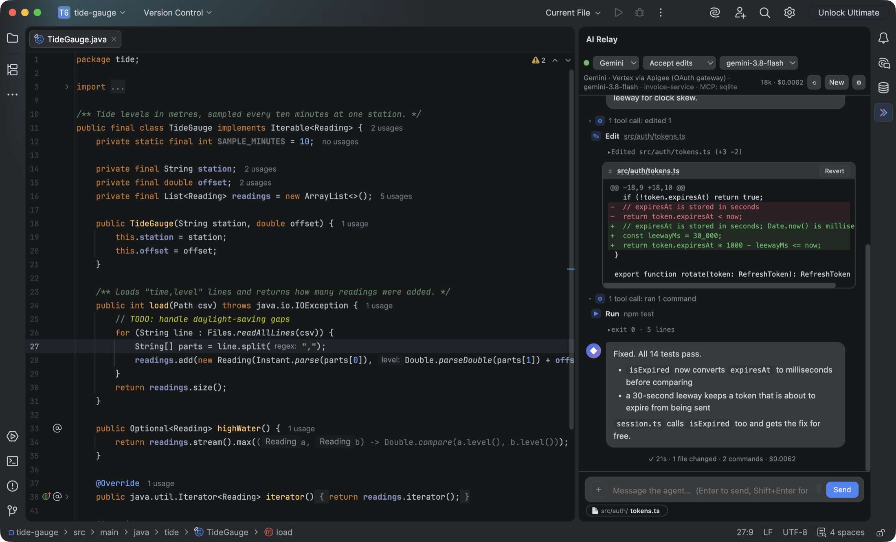
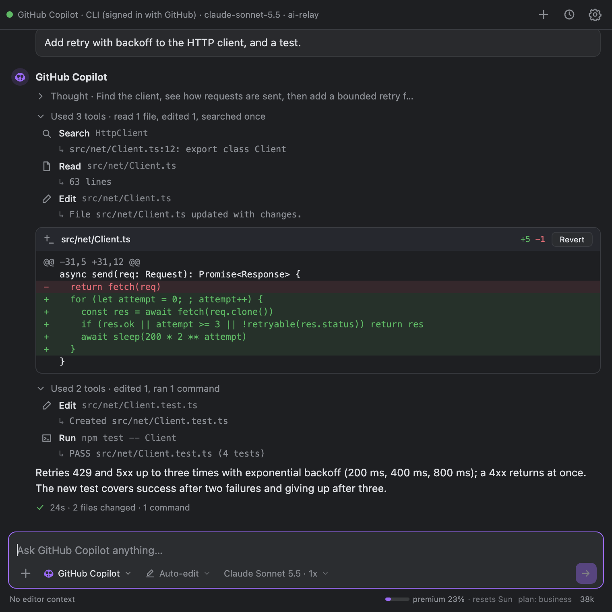
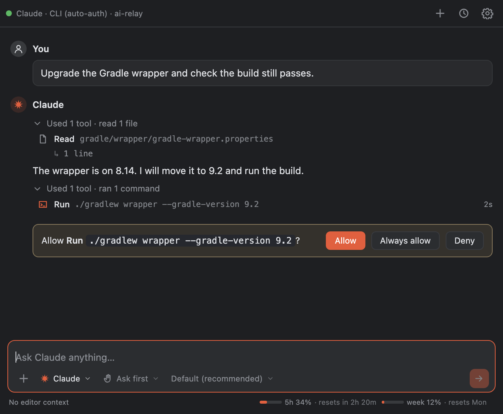
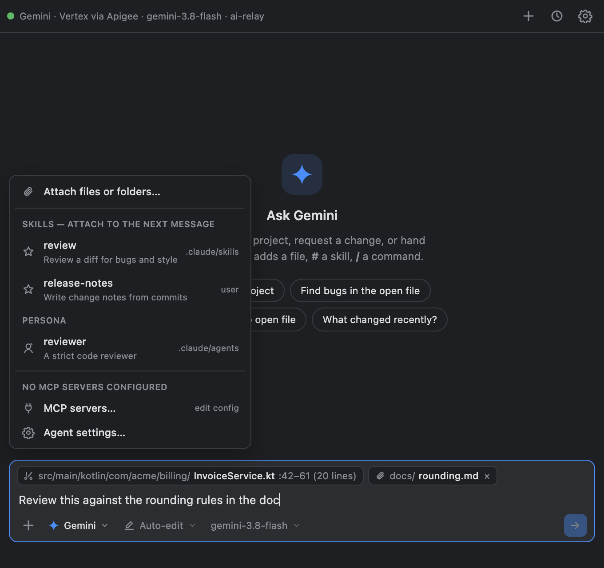
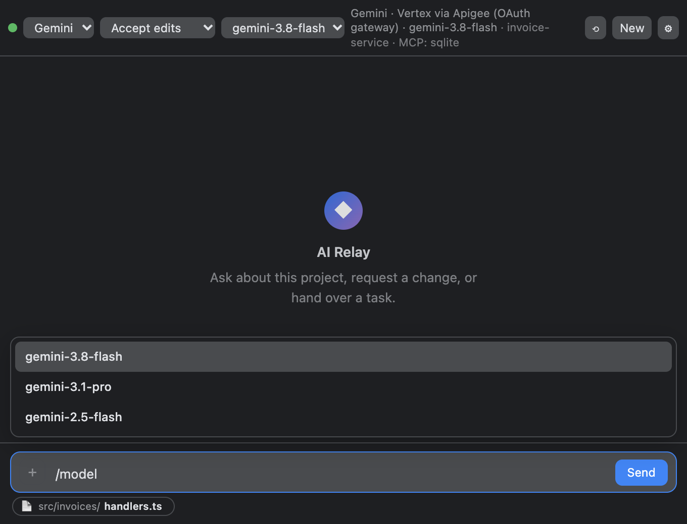

# AI Relay

**Use your company's Gemini — Vertex AI behind an Apigee gateway — as a model
inside GitHub Copilot.**

AI Relay signs in to the gateway with your client credentials and runs a small
local server that Copilot connects to like any other model provider. Copilot
keeps doing what it does (chat, agent mode, editing, running the terminal);
the model answering is your Gemini, billed to your Google Cloud project. The
gateway secret never leaves your machine.

It works with a plain Gemini API key or a standard Vertex project too.

It also has its own chat panel for JetBrains IDEs and VS Code ([below](#in-your-ide)):

<p align="center"></p>

<p align="center">
  
</p>
<p align="center">
  
  
  
</p>

> **Coming from Gemini Relay or Claude Relay?** Both are deprecated, and AI Relay
> replaces them. It takes Gemini Relay's connection modes as they were — run
> `airelay gemini setup` and enter the same gateway values — and drives the same
> `claude` CLI Claude Relay did: pick **Claude** in the panel's agent menu, or run
> `airelay claude`.

## Quick start

**1. Install** — no Java needed, every download carries its own runtime.

```bash
brew install chelayel/tap/airelay                                                   # macOS
curl -fsSL https://raw.githubusercontent.com/Chelayel/ai-relay/main/packaging/install.sh | sh   # macOS / Linux
irm https://raw.githubusercontent.com/Chelayel/ai-relay/main/packaging/install.ps1 | iex        # Windows (PowerShell)
```

Installers (.pkg, .msi, .deb), Scoop, upgrading and removing: [docs/install.md](docs/install.md).

**2. Connect to Gemini**

```bash
airelay gemini setup
```

Pick **Vertex via Apigee** and enter the gateway host, the OAuth token URL,
your client id and secret, and the model ids the gateway publishes. It saves
them to `~/.airelay/config.properties` (owner-only) and offers a live test.

**3. Start the model server, now and at every login**

```bash
airelay serve install
```

It prints exactly what to enter in Copilot:

```
Add to Copilot (Manage Models → Custom Endpoint / OpenAI-compatible) — one entry per model:
  Deployment URL     http://localhost:11435/v1/chat/completions
  API key            air-7f06…
  Model ID          Name                        Tools  Vision  Max input  Max output
  gemini-3.8-flash  Gemini 3.8 Flash            yes    yes        983040       65536
```

`airelay serve status` shows it again at any time; `airelay serve stop` and
`airelay serve uninstall` undo it.

## Connect GitHub Copilot, OpenCode, IntelliJ AI Chat or Air

| Where | How |
| --- | --- |
| **GitHub Copilot** in VS Code and JetBrains | In Copilot Chat's model picker: *Manage Models → Add Models → Custom Endpoint*. Enter the deployment URL, API key and model ids printed above — one entry per model. VS Code keeps them in a JSON file: [example](#vs-code-the-json). |
| **VS Code, shortcut** (1.104+) | With the **AI Relay** extension installed ([Marketplace](https://marketplace.visualstudio.com/items?itemName=chelayel.ai-relay)), the models are already in the picker under *Manage Models* — nothing to paste. |
| **Copilot CLI** | Add a BYOK provider of type `openai` with base URL `http://localhost:11435/v1` and the API key. |
| **OpenCode** | The [opencode-apigee](https://github.com/Chelayel/opencode-apigee) plugin — no `airelay serve` needed — [steps](#opencode). |
| **IntelliJ AI Chat** (AI Assistant) | AI Relay as a model: an OpenAI-compatible provider with URL `http://localhost:11435/v1` — [steps](#intellij-ai-chat-as-a-model). No custom agent needed. |
| **JetBrains Air** | Through OpenCode — [steps](#jetbrains-air-through-opencode). |

Then pick a Gemini model in the model picker and use it as usual.

> **Your Copilot plan must allow outside models.** On Copilot Business and
> Enterprise an administrator can turn "bring your own key" off, and then
> these options do not appear.

The picker offers exactly the models your gateway publishes (the *Apigee
models* setting); adding one in the settings shows it without a restart. With
`gemini.prices` set, the server's log shows what each request cost. Every
detail — what is translated, security, the Ollama route, LiteLLM:
[docs/serve.md](docs/serve.md).

### VS Code: the JSON

*Manage Models → Add Models → Custom Endpoint* opens `chatLanguageModels.json`.
Add one entry per gateway model; VS Code asks for the key (`airelayKey`) once
and keeps it out of the file:

```json
[
  {
    "name": "AI Relay (Gemini)",
    "vendor": "customendpoint",
    "apiKey": "${input:airelayKey}",
    "apiType": "chat-completions",
    "models": [
      {
        "id": "gemini-3.8-flash",
        "name": "Gemini 3.8 Flash",
        "url": "http://localhost:11435/v1/chat/completions",
        "toolCalling": true,
        "vision": true,
        "maxInputTokens": 983040,
        "maxOutputTokens": 65536
      }
    ]
  }
]
```

`maxInputTokens + maxOutputTokens` is what VS Code takes as the context window,
so input is the window less the output (1,048,576 − 65,536). Instead of listing
models, a provider-level `"url": "http://localhost:11435/v1"` lets VS Code
discover them from `/v1/models`. IntelliJ needs no file: its Custom Endpoint
form takes the same values directly.

### IntelliJ AI Chat: as a model

AI Assistant takes AI Relay as an OpenAI-compatible provider directly — no
custom agent and no OpenCode in between:

1. *Settings | Tools | AI Assistant | Providers & API keys* → **Third-party AI
   providers** → the OpenAI-compatible provider.
2. **URL** `http://localhost:11435/v1`, **API Key** the one `airelay serve`
   printed, and turn on **Tool calling**. **Test Connection**, then **Apply**.
3. The gateway's models appear in AI Chat's model selector, in their own
   section. To make one the default, pick it under **Model Assignment →
   Core features**.

### OpenCode

[OpenCode](https://opencode.ai) gets the gateway's models through
[opencode-apigee](https://github.com/Chelayel/opencode-apigee), a provider plugin
that signs in to the gateway itself — `airelay serve` does not need to run for it.

1. **Install OpenCode 1**, with one of OpenCode's own commands:

   ```bash
   curl -fsSL https://opencode.ai/install | bash      # macOS / Linux
   npm install -g opencode-ai                         # anywhere with Node
   brew install anomalyco/tap/opencode                # Homebrew
   ```

   Not `brew install opencode`: that formula installs OpenCode 2, whose plugin
   system opencode-apigee does not support yet.

2. **Add the plugin** to `~/.config/opencode/opencode.json`:

   ```json
   {
     "$schema": "https://opencode.ai/config.json",
     "plugin": ["opencode-apigee"]
   }
   ```

   OpenCode installs it from npm the next time it starts. It reads the gateway,
   project, token URL, client id and secret and the published models from AI
   Relay's config — what `airelay gemini setup` saved — so nothing else is
   needed. Without AI Relay, give them as plugin options; see the
   [plugin's README](https://github.com/Chelayel/opencode-apigee#setup).

3. **Try it in the terminal** before anything else uses it:

   ```bash
   opencode run --model apigee/gemini-3.8-flash "Say hello"
   ```

   with one of the models your gateway publishes in place of `gemini-3.8-flash`
   (`opencode models apigee` lists them). An answer means the gateway, token and
   model are right. In the TUI,
   `/models` → **Gemini via Apigee** picks it.

> **Not on OpenCode's Ecosystem page yet?** Its listing is waiting for review
> ([anomalyco/opencode#58431](https://github.com/anomalyco/opencode/pull/58431)).
> The listing is only a directory entry: the plugin is published on npm, and
> step 2 installs it the same way whether it is listed or not.

<details>
<summary>Or through <code>airelay serve</code>, without the plugin</summary>

Point OpenCode at `airelay serve` as an OpenAI-compatible provider instead
(one entry under `models` per gateway model; the key is the one `airelay serve`
printed):

```json
{
  "$schema": "https://opencode.ai/config.json",
  "provider": {
    "airelay": {
      "npm": "@ai-sdk/openai-compatible",
      "name": "AI Relay (Gemini)",
      "options": {
        "baseURL": "http://localhost:11435/v1",
        "apiKey": "air-…"
      },
      "models": {
        "gemini-3.8-flash": { "name": "Gemini 3.8 Flash", "limit": { "context": 1048576, "output": 65536 } }
      }
    }
  }
}
```

</details>

### JetBrains Air (through OpenCode)

Air runs coding agents over ACP rather than taking a model endpoint, so the
Gemini models reach it through OpenCode, set up and tried in the terminal as
[above](#opencode): Air → OpenCode → your gateway.

1. The agent selector → **Add ACP Agent**, which opens Air's `acp.json`. If Air
   cannot find `opencode`, use the full path that `which opencode` prints — an
   app started from the Dock may not have Homebrew's folders on its PATH:

   ```json
   {
     "agent_servers": {
       "OpenCode (Gemini)": { "command": "opencode", "args": ["acp"] }
     }
   }
   ```

2. Pick **OpenCode (Gemini)** as the agent, and **Gemini via Apigee ›
   Gemini 3.8 Flash** as its model (`/models` in OpenCode switches it).

## In your IDE

AI Relay also has its own chat panel — Gemini first, Microsoft 365 Copilot
second, Claude Code as a bonus — the same agents as the terminal:

| IDE | Get it |
| --- | --- |
| **JetBrains** (IntelliJ IDEA, PyCharm, WebStorm, GoLand, Rider…) | [JetBrains Marketplace](https://plugins.jetbrains.com/search?search=AI%20Relay): *Settings → Plugins → Marketplace*, search **AI Relay**. The CLI is bundled. [Details](intellij-plugin/README.md) |
| **VS Code** | [Visual Studio Marketplace](https://marketplace.visualstudio.com/items?itemName=chelayel.ai-relay): search **AI Relay**. Also adds your Gemini models to Copilot (above). [Details](vscode-extension/README.md) |

Both settings pages write the same `~/.airelay/config.properties`, so one setup
serves the CLI, both IDEs and `airelay serve`.

## In the terminal

AI Relay is also a coding agent of its own over the repo you start it in —
the same agents as the IDE panel:

| Agent | What answers |
| --- | --- |
| `airelay gemini` | your Gemini connection — Apigee, Vertex or an API key (set up in step 2) |
| `airelay copilot` | your signed-in **Microsoft 365 Copilot** web session, driven in a browser tab — no API key, your SSO ([setup](docs/copilot-web.md)) |
| `airelay` | asks which agent, and which folder |

`airelay gemini "fix the failing test"` runs one task and exits; without a
prompt it is an interactive session. Options, keys and configuration:
[docs/cli.md](docs/cli.md).

**Bonus:** if you already use Claude Code, `airelay claude` drives it through
the same prompt and panel.

## More

- [docs/serve.md](docs/serve.md) — `airelay serve` in full
- [docs/install.md](docs/install.md) — install routes, upgrading, removing, corporate proxies, building from source
- [docs/cli.md](docs/cli.md) — the terminal agents
- [docs/copilot-web.md](docs/copilot-web.md) — the Copilot web backend
- [docs/protocol.md](docs/protocol.md) — the JSON protocol the IDE plugins speak
